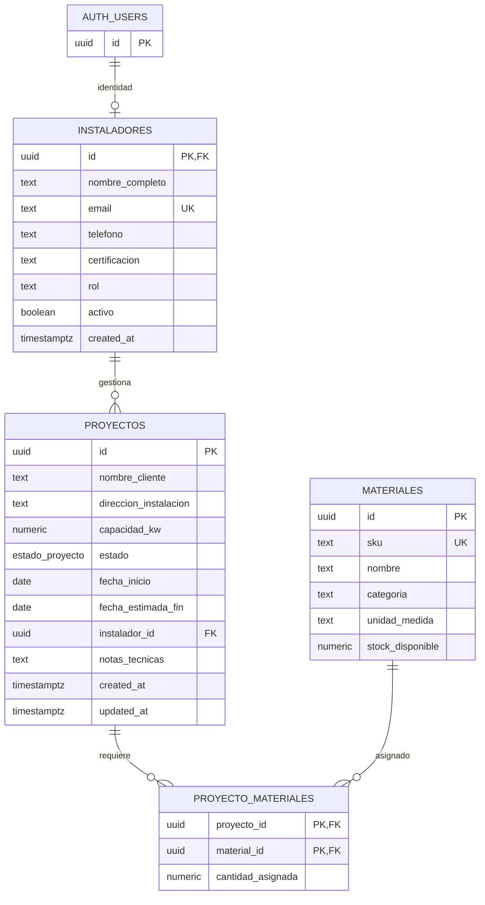

# Arquitectura de SolarOps Manager

## Contrato y alcance SDD

La especificación es el punto de partida: Auth determina identidad, PostgreSQL autoriza filas, el hook coordina acceso a datos y los componentes presentan operaciones. `supabase/schema.sql` es la fuente de verdad del contrato; `src/types/database.types.ts` representa sus filas, inserciones, actualizaciones, relaciones y enum. Las columnas con default son opcionales en Insert; las anulables usan `null`; `NUMERIC` se transporta como `number` y DATE/timestamptz como `string` en supabase-js. La relación con auth.users es externa al esquema público y no se expone como relación PostgREST pública. Las funciones de trigger no son RPC de negocio.

TypeScript usa `strict`, comprobación de código sin usar y ningún tipo `any`. El cliente se instancia una vez, únicamente si existe configuración. AuthProvider restaura con getSession, observa onAuthStateChange y cancela su suscripción al desmontarse. Evita que una restauración tardía sobrescriba un evento de Auth más reciente. El dashboard se monta solo con sesión y se reinicia al cambiar la identidad.

## Seguridad y autorización

Todas las tablas tienen RLS y concesiones explícitas. `anon` carece de acceso. `authenticated` puede SELECT/INSERT/UPDATE solamente cuando la política lo permite; no se concede DELETE. La expresión de proyectos exige perfil activo y `(instalador_id = auth.uid() OR public.es_admin())`. UPDATE tiene USING para la fila anterior y WITH CHECK para la nueva: evita que un instalador reasigne un registro a otro usuario. INSERT aplica la misma autorización. El índice sobre instalador_id respalda el acceso por propietario.

Consultar instaladores desde una política de instaladores para resolver el rol volvería a evaluar la misma política, causando PostgreSQL `42P17` por recursión infinita. `es_admin()` y `es_activo()` son funciones SQL STABLE con SECURITY DEFINER, creadas por `postgres`, que consultan perfiles con los privilegios de su propietario, sin reingresar a RLS. No se aplica FORCE ROW LEVEL SECURITY a esa tabla. Se fija `search_path = ''`, se califican los objetos y no se aceptan UUID arbitrarios: solo resuelven la identidad actual. EXECUTE está revocado de PUBLIC/anon y concedido únicamente a authenticated. No cambies el propietario de estas funciones a un rol sujeto a esas mismas políticas.

Un usuario lee su perfil activo; solo administradores gestionan perfiles, roles y activación. No se usa user_metadata para privilegios. Todos los activos consultan el catálogo de materiales, pero solo administradores lo modifican. Las asignaciones consultan proyectos mediante EXISTS; su RLS se compone con la de proyectos, sin un ciclo hacia instaladores. La cantidad asignada no equivale a reserva ni consumo de stock; ese flujo necesitaría una transacción específica antes de ampliarlo.

El cliente público nunca es una barrera de seguridad. Cambiar el navegador o invocar REST directamente mantiene las mismas políticas. El operador debe aprovisionar el primer administrador por SQL; un usuario no puede promoverse. La autorización por activo se consulta en cada petición, sin esperar a renovar claims. Un cambio de rol o desactivación no borra retrospectivamente datos ya descargados en una sesión; al revocar acceso debe cerrarse también la sesión operativa según el proceso interno.

## Flujo frontend

`App → AuthProvider → useProyectos → supabase-js → PostgreSQL/RLS`.

- ProyectoForm valida campos recortados, capacidad representable por NUMERIC(6,2), fechas reales y orden cronológico. Conserva los datos ante error y limpia solo tras una inserción confirmada. Muestra errores por campo y estado de guardado accesible.
- useProyectos selecciona sin filtro manual por instalador. Gestiona errores, carga, inserción y cambio de estado. Las escrituras usan SELECT de retorno para confirmar que se afectó exactamente un registro; cero filas no se considera éxito.
- La suscripción Postgres Changes se limpia al desmontar. Reconsulta los datos autorizados tras eventos y al conectar/reconectar. Un contador descarta respuestas de consultas obsoletas. Los cambios locales se confirman con datos del servidor. Hay actualización manual si falla el canal.
- DashboardStats deriva indicadores de la lista autorizada. Capacidad total e instalada se distinguen explícitamente. ProyectoList ofrece búsqueda local y estado de guardado/error por fila; no cambia el estado de forma optimista.
- updated_at se calcula en PostgreSQL con un trigger. Las escrituras concurrentes del estado siguen la última escritura confirmada; no hay bloqueo de versión ni historial de auditoría en este alcance.

## Registro del desarrollo por especificaciones

1. Se tradujo el requerimiento en entidades, restricciones, acciones de usuario y límites de autorización.
2. Se definió la migración inicial y sus políticas antes de la presentación; se añadieron políticas para todas las tablas, índices y trigger de timestamp.
3. Se mapeó el contrato público a TypeScript estricto y se separó transporte, sesión, coordinación de datos y presentación.
4. Se implementaron validaciones compartidas y pruebas de límites (espacios, capacidad, fechas imposibles y rangos), además del build de TypeScript/Vite.
5. Se documentaron aprovisionamiento, variables públicas y comprobaciones multiusuario que deben ejecutarse contra el entorno real antes de publicar.

Prompts de trazabilidad y mantenimiento:

- «Define primero tablas, nulabilidad, defaults y reglas de autorización para instaladores y administradores; contrasta cada operación con la especificación».
- «Mapea cada columna a Row/Insert/Update sin any; conserva las relaciones y el enum, y justifica diferencias de representación SQL/JSON».
- «Implementa la vista usando el hook como único coordinador; no añadas un filtro de identidad al SELECT para sustituir RLS».
- «Comprueba límites y errores del contrato; compila con strict y prueba aislamiento con dos instaladores, administrador, inactivo y anónimo».

Estos prompts son una guía reproducible de mantenimiento, no un registro de llamadas a sistemas externos. Para futuras migraciones, actualizar SQL, tipos y pruebas en el mismo cambio; se recomienda regenerar tipos desde el proyecto con la CLI de Supabase y revisar el diff.

## Fuentes técnicas

- [Tailwind CSS v4 con Vite](https://tailwindcss.com/docs/installation/using-vite): plugin oficial @tailwindcss/vite e import CSS.
- [Supabase RLS](https://supabase.com/docs/guides/database/postgres/row-level-security): políticas, funciones SECURITY DEFINER y protección por fila.
- [Supabase Postgres Changes](https://supabase.com/docs/guides/realtime/postgres-changes): publicación y suscripciones a cambios con autorización RLS.

## Límites de verificación

El build comprueba tipos y empaquetado. Las 15 pruebas unitarias verifican el contrato de entrada; otras 11 ejecutan el esquema completo en PostgreSQL embebido (PGlite) y comprueban aislamiento, privilegios, restricciones y timestamps. En estas pruebas auth.users y auth.uid() se simulan: no sustituyen la integración real con Supabase Auth y Realtime. El esquema rechaza NaN explícitamente porque PostgreSQL lo admite en NUMERIC y lo considera mayor que los números finitos. El despliegue requiere ejecutar la migración, aprovisionar cuentas, comprobar aislamiento RLS y sincronización en un proyecto Supabase real. La interfaz no tiene datos ficticios ni usa claves privilegiadas.
