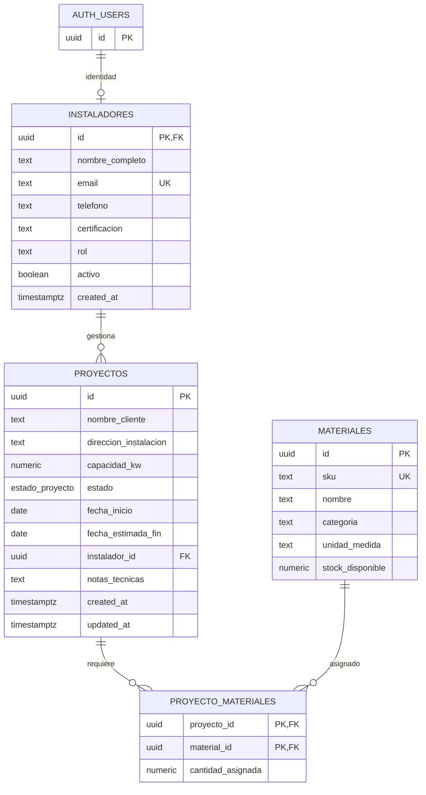

# SolarOps Manager

Aplicación interna para gestionar proyectos de instalación de paneles solares, desarrollada con React 18, TypeScript estricto, Tailwind CSS v4 y Supabase bajo una metodología Specification-Driven Development (SDD).

La aplicación integra autenticación por correo y contraseña, proyectos protegidos por RLS, indicadores operativos, búsqueda y sincronización entre sesiones mediante Supabase Realtime.

## Configuración de Supabase

El backend está configurado en Supabase con PostgreSQL, Auth y Realtime. La estructura de la base de datos está definida en `supabase/schema.sql`, una migración inicial transaccional que establece:

- El enum `estado_proyecto`: `Pendiente`, `En Progreso` y `Completado`.
- Las tablas `instaladores`, `proyectos`, `materiales` y `proyecto_materiales`.
- Claves primarias y foráneas, índices y restricciones de integridad.
- Políticas RLS en todas las tablas y funciones de autorización para perfiles activos y administradores.
- Actualización automática de `updated_at` en los proyectos.
- Cuatro materiales iniciales y la publicación de `proyectos` en Realtime.

La migración corresponde a la creación inicial del esquema y se ejecuta una sola vez por entorno.

### Usuarios y perfiles

El acceso se administra mediante cuentas internas en Supabase Auth y perfiles en `public.instaladores`, vinculados por el mismo UUID. Las contraseñas se gestionan exclusivamente en Auth; la tabla `instaladores` almacena los datos del perfil, su rol y su estado de activación.

El esquema de acceso utiliza dos roles:

- `admin`: consulta todos los proyectos y administra perfiles y materiales.
- `instalador`: consulta y modifica sus propios proyectos.

El registro público está deshabilitado y las cuentas internas se aprovisionan desde la administración de Supabase. Cada cuenta dispone de un perfil con `nombre_completo`, `email`, `rol` y `activo`; `telefono` y `certificacion` son opcionales y `created_at` se genera automáticamente.

Este es el formato utilizado para incorporar nuevos perfiles después de crear la cuenta en Auth:

```sql
insert into public.instaladores (
  id,
  nombre_completo,
  email,
  telefono,
  certificacion,
  rol,
  activo
)
values (
  'UUID_DEL_USUARIO_EN_AUTH',
  'Ana Instaladora',
  'ana@empresa.com',
  null,
  null,
  'instalador',
  true
);
```

Los privilegios se resuelven desde PostgreSQL. Un perfil inactivo no tiene acceso a los datos y un instalador no puede modificar su rol ni reasignar sus proyectos a otro usuario.

## Ejecución local

Requisitos: Node.js 22.12 o superior (recomendado Node 24 LTS) y npm.

Desde la carpeta que contiene `package.json`:

```sh
npm ci
npm run dev
```

La conexión utiliza las variables del archivo `.env`, ubicado junto a `package.json`:

```dotenv
VITE_SUPABASE_URL=https://tu-proyecto.supabase.co
VITE_SUPABASE_ANON_KEY=tu_clave_publica
```

`VITE_SUPABASE_ANON_KEY` contiene la clave pública del proyecto. Las claves privilegiadas y las contraseñas de PostgreSQL permanecen fuera del frontend. `.env` está excluido del repositorio; `.env.example` documenta las variables para reproducir la configuración en otros equipos.

Al modificar las variables de entorno, se reinicia el servidor de Vite. El inicio de sesión utiliza el correo y la contraseña de la cuenta interna de Supabase Auth.

## Funcionalidades

- Creación de proyectos con validación de cliente, dirección, capacidad y fechas.
- Seguimiento por estado: `Pendiente`, `En Progreso` y `Completado`.
- Indicadores por estado, capacidad total y capacidad instalada en proyectos completados.
- Búsqueda por cliente o dirección.
- Cambios de estado confirmados por el servidor y sincronizados mediante Realtime.
- Actualización manual y mensajes de error cuando se interrumpe la conexión.

Los instaladores crean proyectos a su nombre. El administrador visualiza todos los proyectos y puede actualizar sus estados. Las consultas delegan el filtrado de acceso en RLS, sin filtros manuales por instalador en el cliente.

La capacidad admite valores entre 0.01 y 9999.99 kW, con dos decimales. Las fechas se muestran sin conversiones de zona horaria y la fecha estimada de finalización es igual o posterior al inicio.

El inventario y las asignaciones cuentan con modelo y políticas de acceso. Las asignaciones registran cantidades y el stock se mantiene de forma independiente. La interfaz de proyectos permite crear, consultar y actualizar estados.

## Verificación

La compilación de producción y las 26 pruebas automatizadas se ejecutaron correctamente. La auditoría de dependencias realizada durante la entrega no reportó vulnerabilidades.

```sh
npm test
npm run build
```

La suite incluye 15 casos de validación y 11 pruebas del esquema SQL y sus políticas RLS en PostgreSQL embebido (PGlite), con identidades simuladas. Comprueba aislamiento entre instaladores, acceso de administradores, perfiles inactivos, protección de roles, restricciones y actualización de timestamps.

## Distribución

`npm run build` genera la aplicación estática en `dist/`. El artefacto se sirve mediante un hosting con HTTPS. Las variables `VITE_` se incorporan durante la compilación y contienen únicamente configuración pública.

La vista previa local del artefacto se inicia con:

```sh
npm run preview
```

## Documento de arquitectura (Markdown)

La documentación de arquitectura se presenta en formato Markdown en [ARCHITECTURE.md](ARCHITECTURE.md). Describe el modelo de datos, la separación de responsabilidades, las políticas RLS y el flujo de desarrollo guiado por especificaciones. A continuación se incluyen el diagrama de la base de datos, la estructura del repositorio y el prompt inicial que definió la implementación.

### Diagrama de la base de datos



Cada perfil de instalador está vinculado a una cuenta de Supabase Auth. Un instalador gestiona varios proyectos y cada proyecto puede tener varios materiales mediante `proyecto_materiales`, cuya clave primaria compuesta evita duplicar el mismo material en un proyecto.

### Estructura y responsabilidades

```text
├── supabase/
│   ├── schema.sql
│   └── schema.test.mjs
├── src/
│   ├── types/database.types.ts
│   ├── lib/
│   │   ├── supabase.ts
│   │   ├── proyectoValidation.ts
│   │   └── proyectoValidation.test.ts
│   ├── context/AuthContext.tsx
│   ├── hooks/useProyectos.ts
│   ├── components/
│   │   ├── DashboardStats.tsx
│   │   ├── ProyectoForm.tsx
│   │   └── ProyectoList.tsx
│   ├── App.tsx
│   ├── main.tsx
│   ├── index.css
│   └── vite-env.d.ts
├── .env.example
├── ARCHITECTURE.md
├── README.md
├── package.json
├── package-lock.json
├── tsconfig.json
└── vite.config.ts
```

| Ubicación                 | Responsabilidad                                                                                                  |
| ------------------------- | ---------------------------------------------------------------------------------------------------------------- |
| `supabase/`               | Define tablas, relaciones, restricciones, semillas y políticas RLS; verifica el esquema con PostgreSQL embebido. |
| `src/types/`              | Representa el contrato SQL con tipos estrictos para filas, inserciones, actualizaciones, relaciones y estados.   |
| `src/lib/`                | Centraliza el cliente de Supabase, el manejo de errores y la validación de los datos del formulario.             |
| `src/context/`            | Mantiene la sesión y expone las operaciones de inicio y cierre de sesión.                                        |
| `src/hooks/`              | Coordina consultas, creación, cambios de estado y sincronización Realtime de los proyectos.                      |
| `src/components/`         | Presenta los indicadores, el formulario y la tabla interactiva.                                                  |
| `src/App.tsx`             | Orquesta el login y el dashboard protegido.                                                                      |
| `src/main.tsx`            | Inicia React y proporciona el contexto de autenticación.                                                         |
| `src/index.css`           | Integra Tailwind CSS v4 y los estilos compartidos.                                                               |
| Archivos de configuración | Definen dependencias, compilación, tipado estricto y variables públicas de conexión.                             |

El flujo de datos sigue `Componentes → useProyectos → cliente Supabase → PostgreSQL/RLS`. Auth aporta la identidad; PostgreSQL determina qué filas puede consultar o modificar cada usuario. La función `es_admin()` utiliza `SECURITY DEFINER` y un `search_path` fijo para consultar roles sin provocar la recursión de políticas asociada al error `42P17`.

### Prompt clave utilizado: especificación inicial

Se documenta únicamente el primer prompt, que estableció el alcance y los requisitos detallados del proyecto. La siguiente síntesis conserva sus instrucciones técnicas y criterios de aceptación.

> Actúa como un Arquitecto de Software Senior especialista en React, TypeScript, Tailwind CSS y Supabase. Construye desde cero el repositorio **SolarOps Manager**, una aplicación interna para gestionar proyectos de instalación de paneles solares bajo **Specification-Driven Development (SDD)**, preparada para producción.
>
> **Stack obligatorio:** React 18 o superior con Vite, TypeScript con `strict: true` y sin utilizar `any`, Tailwind CSS v4, `lucide-react` y `@supabase/supabase-js` para Auth y PostgreSQL con RLS.
>
> **Arquitectura modular:** genera `supabase/schema.sql`, `src/types/database.types.ts`, `src/lib/supabase.ts`, `src/context/AuthContext.tsx`, `src/hooks/useProyectos.ts`, los componentes `DashboardStats.tsx`, `ProyectoForm.tsx` y `ProyectoList.tsx`, `App.tsx`, `main.tsx`, `.env.example`, `ARCHITECTURE.md` y `README.md`, respetando la separación de responsabilidades.
>
> **Base de datos:** define el enum `estado_proyecto` con `Pendiente`, `En Progreso` y `Completado`. Crea `instaladores` con UUID vinculado a `auth.users`, nombre completo, email único, teléfono, certificación, rol `admin` o `instalador`, activo y fecha de creación. Crea `proyectos` con UUID, cliente, dirección, capacidad `NUMERIC(6,2)` mayor que cero, estado, fechas de inicio y fin estimado, instalador, notas técnicas y timestamps. La fecha de fin debe ser nula o igual o posterior al inicio. Crea `materiales` con UUID, SKU único, nombre, categoría, unidad y stock no negativo; relaciona proyectos y materiales mediante `proyecto_materiales` con cantidad asignada mayor que cero. Incluye datos semilla de materiales.
>
> **Seguridad:** habilita RLS en todas las tablas y crea `public.es_admin()` con `SECURITY DEFINER` para evitar recursión infinita al consultar roles. Las políticas SELECT, INSERT y UPDATE de proyectos deben permitir acceso cuando `instalador_id = auth.uid() OR public.es_admin()`.
>
> **Autenticación y acceso a datos:** utiliza un cliente singleton configurado con `VITE_SUPABASE_URL` y `VITE_SUPABASE_ANON_KEY`. AuthContext debe restaurar y observar la sesión mediante `getSession()` y `onAuthStateChange()`, y exponer `session`, `user`, `loading`, `signIn` y `signOut`. El hook `useProyectos` debe gestionar proyectos, carga, errores, creación y actualización de estado, dejando que RLS filtre en el servidor sin añadir filtros manuales por instalador al SELECT.
>
> **Interfaz y validación:** el formulario debe exigir cliente de al menos 3 caracteres, dirección de al menos 5, capacidad positiva, fecha de inicio y fecha final igual o posterior al inicio cuando esté presente. Debe mostrar errores claros y limpiarse únicamente tras guardar correctamente. El dashboard debe mostrar indicadores por estado y capacidad en kW; la tabla debe permitir cambios de estado mediante un select conectado a `actualizarEstado`.
>
> **Documentación:** incluye un diagrama ERD en Mermaid, la justificación de RLS y `SECURITY DEFINER` frente al error PostgreSQL `42P17`, y el registro del desarrollo guiado por especificaciones y tipado estricto. Documenta la instalación, configuración de Supabase, variables de entorno y ejecución local.
>
> **Criterios de entrega:** revisa `package.json`, instala las dependencias necesarias, genera código limpio y modular, y ejecuta `npm run build` para comprobar que no haya errores de compilación ni de tipos.
